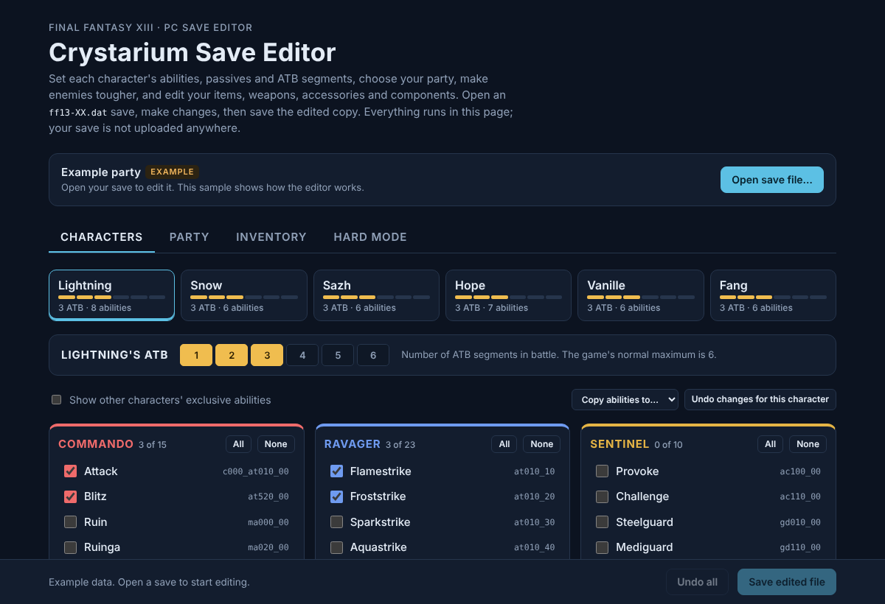

# Crystarium Save Editor

A save editor for **Final Fantasy XIII on PC (Steam)**, plus an optional hard mode that makes enemies tougher.



## Features

- **Roles**: view and set each character's stored role levels (0–5). Raising a locked role doesn't add its crystal to the Crystarium; the game does that through a Chapter 10 story event.
- **Abilities**: choose exactly which Crystarium abilities each character has, role by role. Abilities made for another character (Army of One, Highwind, and so on) can be shown and added too.
- **Passives**: find the accessory or weapon that carries a passive such as Auto Haste and add it to your inventory, ready to equip.
- **ATB**: set each character's ATB segments from 1 to 6.
- **Party**: choose the leader, the battle team and the reserve.
- **Inventory**: consumables, components, weapons and accessories. Each owned weapon or accessory can be turned into a different one (which changes its passive) and given any level up to the item's real maximum. Equipped gear can be changed but not removed.
- **Hard mode**: scale enemy HP, Strength, Magic and CP rewards for all enemies, bosses only, or regular enemies, or set exact values per enemy. This changes the game's data files and comes with an installer and a one-click restore.

The editor never uploads anything. Saves and game files are read and written on your own computer.

## Download

Get the latest build from the [Releases](../../releases) page:

- **`CrystariumSaveEditor-x.y.z-portable.exe`** is a desktop app that needs no install. Windows SmartScreen may warn that the app is unrecognized, because it isn't code-signed. Choose "More info", then "Run anyway".
- **`ff13-save-editor.html`** is the same editor as a single web page. Open it in Chrome, Edge or Firefox.

## Editing a save

1. Close the game and **back up your save folder**. Steam keeps FF13 saves in
   `C:\Program Files (x86)\Steam\userdata\<your id>\292120\remote` as `ff13-00.dat`, `ff13-01.dat`, and so on.
2. Click **Open save file…** and pick a save.
3. Make your changes, then click **Save edited file**. Put the edited `.dat` back in the save folder, replacing the original.
4. If Steam reports a cloud-save conflict, keep the local file.

Test edits on a copy in a spare save slot first.

## Hard mode

Enemy stats aren't stored in your save. They're in `db/resident/bt_chara_spec.wdb` inside the game's archive, so hard mode patches the game files:

1. On the **Hard mode** tab, choose `filelistu.win32.bin` and `white_imgu.win32.bin` from `FINAL FANTASY XIII\white_data\sys`. Also add `filelistc.win32.bin` and `white_imgc.win32.bin` if you play with Japanese voices.
2. Pick a preset (Hard, Very hard, Brutal) or set your own percentages, and adjust individual enemies if you want.
3. Click **Build hard mode**, then extract the zip into your `FINAL FANTASY XIII` folder, next to `FFXiiiLauncher.exe`.
4. Close the game and run **`install.bat`**. It saves the original data to `hardmode_backup` before changing anything.
5. Run **`restore.bat`** to go back to the original enemies. Steam's "Verify integrity of game files" also undoes it.

Running a newer build's `install.bat` restores the backup first, so settings never stack.

## How it works

- **Saves**: `ff13-XX.dat` is a 0x208-byte plain header followed by a body encrypted with the same cipher as the PS3/Xbox 360 versions, using a different key. The editor decrypts the body, edits it, updates the checksum in the last 4 bytes, and encrypts it again. Unchanged saves come back byte-identical.
- **Roles** are six 32-bit role levels at +0xC28 (Sentinel, Commando, Ravager, Synergist, Saboteur, Medic; 0 = locked).
- **Abilities** are a list of 16-byte ability IDs in each character's 0xD80-byte record, with a count byte at +0x27. ATB is at +0xC58 (segments × 10).
- **Inventory** uses fixed bags of 20-byte entries. Weapons and accessories point into a 512-entry equipment table that stores the equipped flag and level.
- **Hard mode** finds `bt_chara_spec.wdb` through the archive's file list and recompresses the edited table. The installer writes it back in its original place, which has room to spare, and updates only that file's size in the file list.

## Building from source

```sh
python build.py            # writes dist/ff13-save-editor.html and app/index.html
cd app
npm install
npm start                  # run the desktop app
npm run dist               # build the portable Windows exe into app/dist
```

Pushing a tag such as `v1.0.0` makes GitHub Actions build the exe and attach it to a release.

## Credits

- The save cipher is based on the FFXIII save decrypter in [bucanero/save-decrypters](https://github.com/bucanero/save-decrypters) (GPL-3.0), which builds on work by Jappi88 and Shademp.
- The ability, item, enemy and passive tables come from [Bartz24/FFModdingWPF](https://github.com/Bartz24/FFModdingWPF) (MIT, see `third_party/`).
- Some offsets were cross-checked against [KiraTheReaper435/ff13-save-editor-software](https://github.com/KiraTheReaper435/ff13-save-editor-software).

## License

GPL-3.0. See [LICENSE](LICENSE).

This is a fan project. It is not affiliated with or endorsed by Square Enix. Final Fantasy XIII is a trademark of Square Enix.
